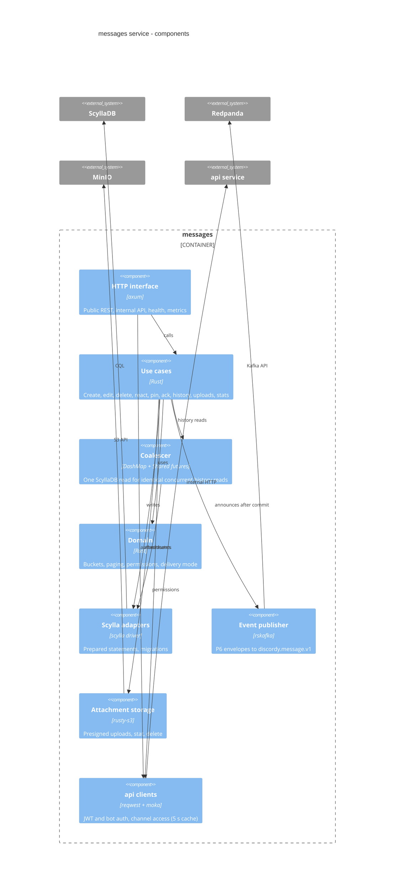

# Architecture

Clean Architecture in a Cargo workspace. Dependencies point inward only.

| Crate | Layer | Content |
|---|---|---|
| `crates/domain` | domain | Snowflakes, buckets, paging planner, access rules, message, reactions, read state. No IO. |
| `crates/application` | application | One use case per file, ports (traits), `Coalescer`, `HistoryReader`. |
| `crates/infrastructure` | adapters | ScyllaDB repositories and CQL migrations, Redpanda producer, MinIO storage, api-service clients. |
| `crates/interface` | interface | axum routes, DTO mapping, error envelope, event envelope encoder. |
| `crates/contracts` | wire types | DTOs matching the pinned interfaces, swappable for the generated package. |
| `bin/messages` | composition root | Configuration, wiring, startup and shutdown. |

## Decisions

- **Bucketed partitions.** Messages are keyed by `(channel_id, 10-day bucket)`. Paging walks
  buckets backwards from the channel's last message until the page is full or the creation
  bucket is reached.
- **Last message id** is a separate table written with a timestamp derived from the message id,
  so late writes never move it backwards. Timestamps are unix microseconds, which ScyllaDB
  requires.
- **Coalescing.** Every history partition read goes through `Coalescer`, so a burst of identical
  reads costs one query.
- **Write then publish.** ScyllaDB is the source of truth. A failed publish is logged, not
  surfaced, because the write is already durable.
- **Delivery modes.** The access endpoint of the api service reports the effective mode; only
  `standard` is accepted (409, code 50160).
- **Uploads.** Presigned PUT URLs are signed against the CDN origin; the CDN path prefix is
  added afterwards, because the ingress strips it before MinIO verifies the signature.
- **Downloads.** The bucket is private. Message attachments carry Discord-style signed URLs
  `{CDN}/attachments/{channel}/{id}/{file}?ex&is&hm` (HMAC-SHA256, 24 h, re-signed on every
  serialization). `GET /attachments/...` verifies them and streams the object from MinIO, with
  `Range` support; the ingress routes that path to this service. Expired links answer 410.
  `POST /channels/{id}/attachments/refresh-urls` re-signs object keys or old URLs of that channel
  for members who can read it (Ephemeral recipients get their links there).
  See docs ADR 0017.
- **@here.** `Mentions.here` marks a message whose only broadcast tag is `@here`; `mention_everyone`
  stays true for it (Discord parity) and the DTO adds `mention_here`. messages holds no presence and
  does not fan out per-user pings for broadcast tags (read-state counts cover explicit user
  mentions), so the online-only filter belongs to the gateway, which owns presence and reads
  `mention_here` from MESSAGE_CREATE.
- **System messages.** Types 1-7 and 18 are stored like messages with no user text. Pins post
  type 6 from this service (`reply_to` is the pinned message). Joins (7), threads (18) and calls
  (3) are posted by api and voice through `/internal`; a call's end arrives later through
  `PATCH .../call`, which updates the stored `call` and publishes MESSAGE_UPDATE.
- **Events** are keyed by `channel_id`, partitioned with Kafka's murmur2 so ordering per
  channel holds.

## Notifier

`crates/notifier` is a library with its own layers (`domain`: decision rules and push text, no IO; `application`: ports, `EventHandler`, the bounded `Dispatcher`; `infrastructure`: APNs, the api client, the Redpanda consumer) and `bin/notifier` is its composition root. It shares only `contracts` with the messages service and ships as a separate image. Who gets a push is decided by `domain::decide` from the facts the api resolves (effective level, mute, role ids, live session), so the rules sit next to the client rules they mirror. What a push says is decided by `domain::compose`, which is fail-closed: only the delivery mode `standard` may show text. The only event besides a new message that produces a push is a DM call starting (the call system message), which becomes a PushKit `Voip` push through `EventHandler::ring` and `domain::compose_call`, under the same allow-list for names. See the README for back-pressure and the single-replica constraint.
